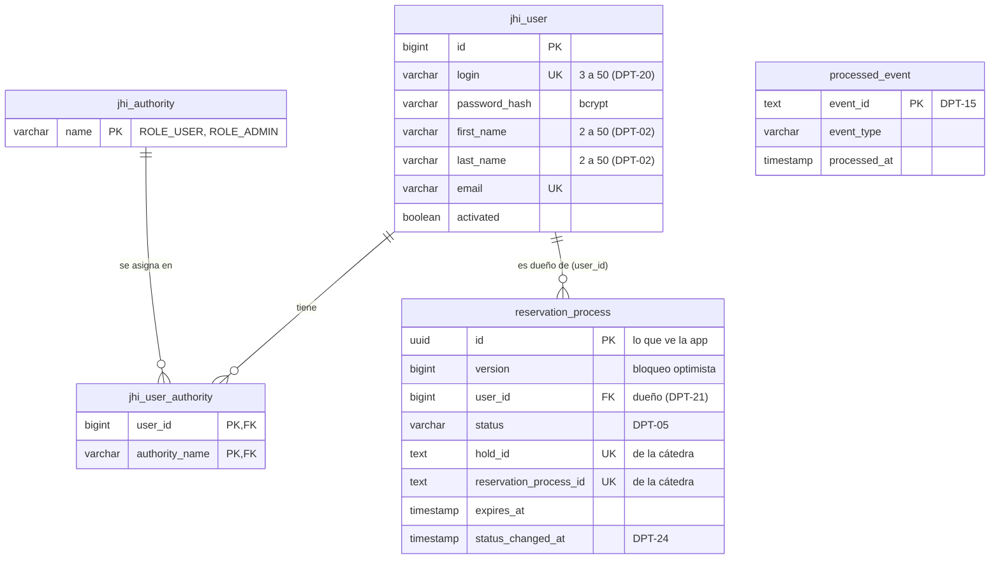

# Modelo de datos del servicio de turnos

Qué guarda este servicio, en qué tablas, con qué reglas, y qué datos **no** son suyos. Cubre el punto del
enunciado §12 "el modelo de datos de cada servicio y la delimitación de su propiedad". La máquina de estados y
la recuperación están en [`reservas.md`](reservas.md).

La base es una PostgreSQL propia (`turnos`, usuario `turnos_app`, [ADR 0001](adr/0001-postgresql.md)), sin
permisos sobre la del catálogo. El esquema lo crea Liquibase ([ADR 0002](adr/0002-liquibase.md)) y Hibernate
solo lo valida.

## 1. Las tablas

| Tabla | De quién | Changelog | Para qué |
| --- | --- | --- | --- |
| `jhi_user`, `jhi_authority`, `jhi_user_authority` | JHipster | `00000000000000_initial_schema.xml`, `20261022120000_jhi_user_email_254.xml` | Usuarios finales, roles y login (CU-01, CU-02). Turnos es el dueño de los usuarios ([ADR 0003](adr/0003-emision-jwt-y-usuarios.md)) |
| `reservation_process` | feature `reservation` | `reservation/001-reservation-process.xml` | Un proceso de reserva por fila, desde que se pide el hold hasta su estado final |
| `processed_event` | feature `reservation` | `reservation/002-processed-event.xml` | Los `eventId` de Kafka ya procesados (idempotencia, DPT-15) |

Los changelogs de la feature están en `config/liquibase/changelog/reservation/`, uno por tabla y en XML,
separados de los de JHipster. Un changeset aplicado no se edita: una corrección va en uno nuevo. `processed_event`
no tiene FK a `reservation_process`: registra también eventos de procesos que no existen (CU-07 2.2a).

La feature lee `jhi_user` con una entidad propia de solo lectura (`UserProfileEntity`, `@Immutable`), solo las
columnas que necesita (el nombre y el apellido del paciente, CU-04). Nunca usa `User`, `UserRepository` ni
`UserService` de JHipster.

## 2. `reservation_process`, columna por columna

| Columna | Tipo | Qué es | Tiene valor |
| --- | --- | --- | --- |
| `id` | `uuid` | Identificador local, el único que ve la app. UUID v4 que genera el caso de uso: una secuencia dejaría deducir cuántos procesos hay | siempre |
| `version` | `bigint` | Bloqueo optimista (`@Version`, DPT-09). Un `UPDATE` con una versión vieja no pisa: falla, y el que perdió relee | siempre |
| `user_id` | `bigint` FK `jhi_user` | **El dueño** (DPT-21). Es lo que autoriza: cada consulta de un usuario filtra por él | siempre |
| `user_login` | `varchar(50)` | El login al iniciar la reserva. Solo para mostrar y trazabilidad: un admin lo puede cambiar, nunca autoriza | siempre |
| `professional_id`, `appointment_date`, `start_time`, `end_time` | `bigint`, `date`, `time`, `time` | El turno. Horas **locales** de atención, sin zona (contrato §4) | siempre |
| `professional_first_name`, `professional_last_name`, `professional_category_name`, `slot_duration_minutes` | `varchar(100)`, `integer` | Datos **históricos** del profesional al iniciar la reserva, solo para mostrar (DPT-12). No son una réplica del catálogo y nunca se usan para decidir | siempre |
| `patient_first_name`, `patient_last_name` | `varchar(100)` | El paciente (el titular de la cuenta, DPT-02), tal como se mandó en el confirm. **Dato personal** | siempre |
| `status` | `varchar(30)` | El estado (DPT-05) | siempre |
| `hold_id`, `reservation_process_id`, `expires_at` | `text`, `text`, `timestamp` | Lo que devolvió la cátedra al crear el hold. Con `reservation_process_id` llegan los eventos de Kafka y se cruza con `GET /api/appointments`. `expires_at` lo manda la cátedra y cada evento que trae uno lo reemplaza | desde `HOLD_CREATED`; en `FAILED`, si se llegó a crear el hold |
| `request_event_id`, `phone_request_message` | `text` | El `eventId` y el mensaje de `AdditionalInformationRequested`: el `eventId` se manda como `requestEventId` del teléfono (contrato §15.5) | desde `PHONE_REQUESTED` |
| `phone_number` | `varchar(16)` | El teléfono enviado, normalizado. **Dato personal** | desde `PHONE_SUBMITTED` |
| `last_submitted_event_id` | `text` | El `eventId` del último `AdditionalInformationSubmitted` (uno nuevo en cada envío) | desde el primer envío del teléfono |
| `rejection_reason`, `rejection_message` | `text` | El último rechazo del teléfono | desde `PHONE_REJECTED` (se conserva si después se confirma) |
| `reservation_id`, `confirmed_at` | `bigint`, `timestamp` | La reserva confirmada en la cátedra y cuándo | en `CONFIRMED`; en `CANCELLED`, si se conoce |
| `cancellation_reason`, `cancelled_at` | `varchar(500)`, `timestamp` | La cancelación: el motivo (opcional, del usuario o de la cátedra) y cuándo la aplicó la cátedra | en `CANCELLED` |
| `closing_reason`, `closing_message` | `text` | Por qué terminó: un código de la cátedra o propio (los valores están en [`api-rest.md`](api-rest.md#el-proceso-de-reserva)) | en `EXPIRED`, `INVALID` y `FAILED` |
| `created_at` | `timestamp` | Cuándo se inició | siempre |
| `status_changed_at` | `timestamp` | El último cambio **de estado** (no cualquier escritura): la antigüedad que mira la reconciliación (DPT-24) | siempre |

Los instantes se guardan en UTC (`hibernate.jdbc.time_zone: UTC`); las horas del turno, sin convertir de zona
(`@JdbcTypeCode(SqlTypes.LOCAL_TIME)`), y las búsquedas por hora mandan el valor como texto con
`cast(... as time)`.

### Restricciones

La base garantiza lo que no puede quedar librado al código (que el modelo valide también es una segunda capa):

| Restricción | Qué asegura |
| --- | --- |
| `pk_reservation_process` (`id`) | Un proceso por id |
| `uq_reservation_process_hold_id`, `uq_reservation_process_reservation_process_id` | Un proceso local por hold y por proceso de la cátedra: un evento nunca encuentra dos (contrato §7, "sin duplicar reservas"). PostgreSQL admite varios `NULL` |
| `fk_reservation_process_user` | Todo proceso tiene un dueño que existe |
| `ck_reservation_process_status` | Solo los 11 estados de DPT-05 |
| `ck_reservation_process_hold_all_or_none` | `hold_id`, `reservation_process_id` y `expires_at` van juntos |
| `ck_reservation_process_hold_by_status` | `CREATING_HOLD` sin hold; los demás, salvo `FAILED`, con hold |
| `ck_reservation_process_confirmation` | `reservation_id` y `confirmed_at` juntos, y obligatorios en `CONFIRMED` |
| `ck_reservation_process_time_range`, `ck_reservation_process_slot_duration` | El turno empieza antes de terminar; la duración es positiva |
| `uq_reservation_process_one_intermediate_per_user` | **Índice único parcial** sobre `user_id` con `status` en los 6 intermedios: un usuario tiene a lo sumo una reserva en curso (DPT-17), aunque lleguen dos pedidos a la vez. Es uno de los motivos de PostgreSQL (ADR 0001) |
| `idx_reservation_process_user` | Las consultas por dueño (CU-08, CU-09, CU-12 con filtro) |

**Índices medidos en el #14** (`EXPLAIN ANALYZE` con 10 000 procesos de 1000 usuarios): "Mis reservas" usa
`idx_reservation_process_user` (0,06 ms); la reconciliación, el índice único parcial (0,6 ms con 1000
intermedios); la consulta de administrador sin filtro de usuario recorre la tabla (2 ms). No hizo falta un
índice nuevo.

## 3. La propiedad: qué es de quién

| Dato | Dueño | Cómo lo obtiene turnos | Qué guarda turnos |
| --- | --- | --- | --- |
| Usuarios finales, contraseñas, roles | **turnos** | Es suyo: registro, login y emisión del JWT ([ADR 0003](adr/0003-emision-jwt-y-usuarios.md)) | `jhi_*` |
| Procesos de reserva y su estado local | **turnos** | Es suyo | `reservation_process` |
| Eventos de Kafka ya procesados | **turnos** | Es suyo | `processed_event` |
| Profesionales, categorías y horarios semanales | **catálogo** | Por contrato REST, en cada operación que los necesita: `GET /api/service/professionals/{id}/agenda` con un token técnico de servicio ([contratos entre servicios](https://github.com/MLucentiniProgramacion2/DOCUMENTACION/blob/main/CONTRATOS_ENTRE_SERVICIOS.md)). **Nunca** por la base: turnos no tiene acceso a la del catálogo | Solo los datos históricos del profesional dentro del proceso, para mostrar (DPT-12) |
| Holds, reservas, ocupaciones y el resultado de cada proceso | **cátedra** | Por su API REST (ocupaciones, hold, confirm, listado, cancelación) y por Kafka (pedido de teléfono y resultados) | Los identificadores (`hold_id`, `reservation_process_id`, `reservation_id`, `request_event_id`) y los datos de cada hecho, como referencia: **no son FK**, la fuente de verdad es la cátedra |
| El teléfono | lo informa el usuario | `POST /api/reservation-processes/{id}/phone` | `phone_number`, y se publica en el topic de teléfono |

La cátedra identifica las operaciones por la cuenta técnica (`groupId`); **la propiedad por usuario la aplica
turnos** con `user_id` (enunciado §4.2). `externalPatientId = "user-" + id` es solo un filtro auxiliar hacia la
cátedra (DPT-01): una reserva de la cátedra sin proceso local no se le muestra a nadie.

## 4. Datos personales y cómo se protegen

| Dato | Dónde | Protección |
| --- | --- | --- |
| Contraseña | `jhi_user.password_hash` | Hash bcrypt (JHipster). Nunca sale en una respuesta ni en el log |
| Nombre y apellido del paciente | `reservation_process.patient_*` | No salen en ninguna respuesta (ni la del usuario ni la de administrador). `PatientName.toString()` los enmascara; la entidad los excluye de su `toString()` |
| Teléfono | `reservation_process.phone_number` | Igual: ni en respuestas ni en el log. `PhoneNumber.toString()` lo enmascara; el productor de Kafka usa un `ProducerListener` que no loguea el registro; los tests capturan el log de un flujo completo y buscan los dígitos |
| Motivo de cancelación | `reservation_process.cancellation_reason` | Lo escribe el usuario: sale en su propia respuesta, va a la cátedra, y no va al log ni a la respuesta de administrador (solo si hubo uno). `Cancellation.toString()` lo enmascara |
| Teléfono y nombres de los pacientes de **toda la cuenta técnica** | Respuesta de `GET /api/appointments` | El DTO del cliente no declara esos campos: nunca llegan a un objeto de turnos. El cuerpo nunca se loguea |
| Login | `jhi_user.login`, `reservation_process.user_login` | Los logs de JHipster registran el `id` del usuario, no el login (#10) |

Los tokens (el JWT del usuario, el técnico de la cátedra y el de servicio) nunca se guardan en la base.

## 5. Límites conocidos

- **`processed_event` crece sin límite:** se registra cada evento procesado y no hay una limpieza. Con el
  volumen del proyecto no es un problema; en producción haría falta borrar los registros más viejos que el
  tiempo máximo de reentrega de Kafka.
- **Un `reset` de la base local** deja reservas de la cátedra sin proceso: no se muestran a nadie (DPT-01), y
  los `externalPatientId` nuevos pueden coincidir con los viejos. Por eso la propiedad nunca sale de la cátedra.
