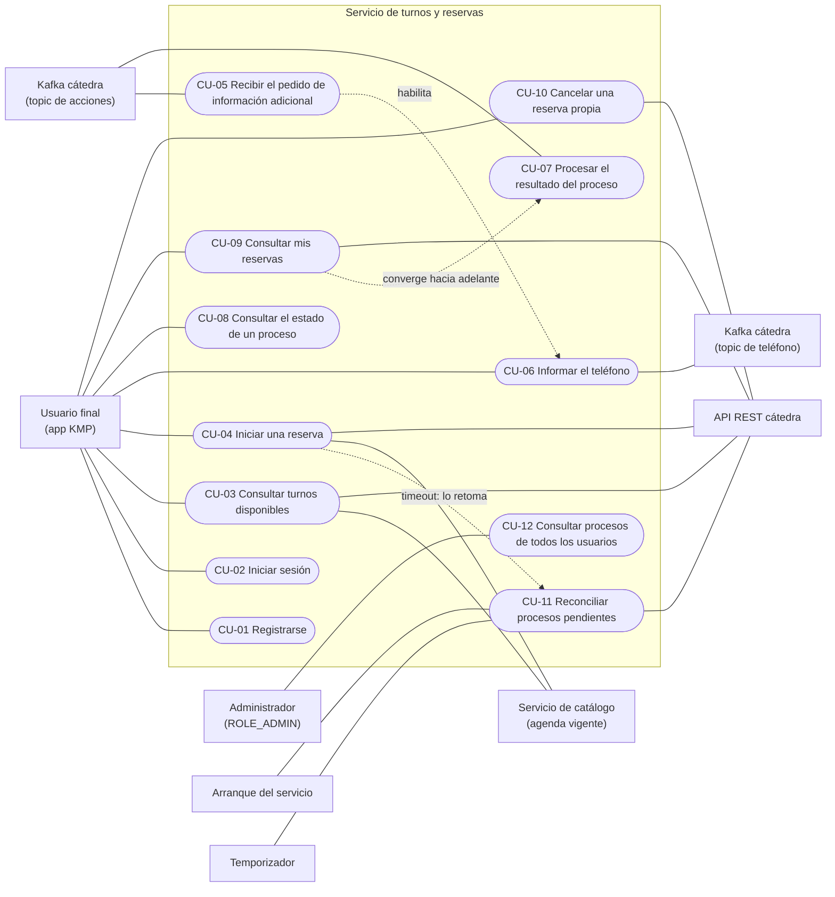
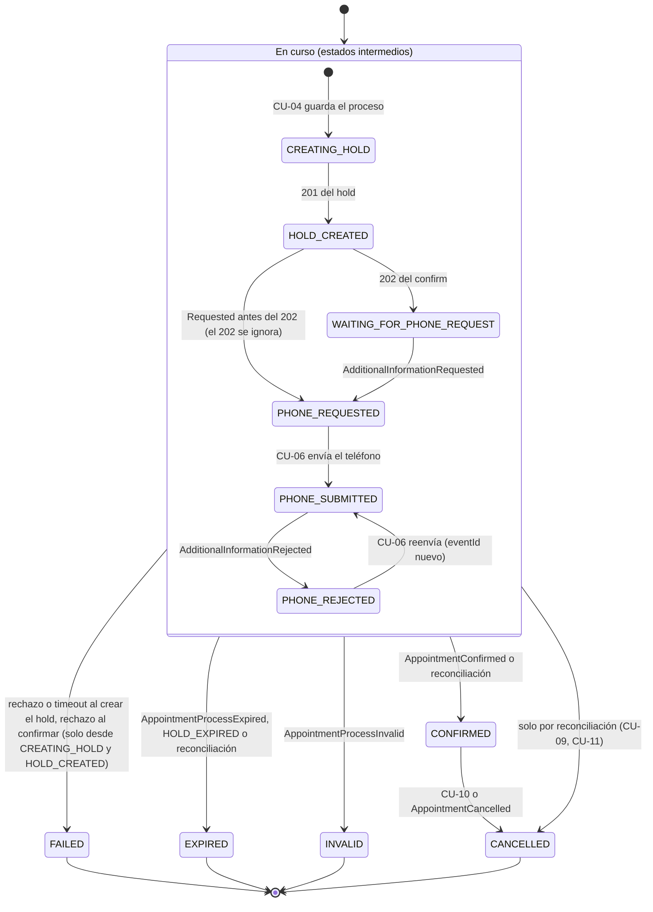

# Casos de uso del servicio de turnos y reservas

Casos de uso del servicio de turnos, escritos antes de implementar. Cada caso indica la sección
del enunciado (`PROJECT_STATEMENT-v1.md`) o del contrato (`INTEGRATION_REFERENCE-v2.md`) que lo
respalda. Las decisiones de diseño que el enunciado deja a cargo del alumno quedan registradas como
**Decisión del proyecto (DPT-xx)** en el caso que corresponde. El prefijo `DPT` las distingue de
las decisiones del servicio de catálogo (`DP-xx`), que acá se citan como "DP-xx del catálogo".

## Supuestos generales

- **Turnos no guarda el catálogo.** La agenda vigente se pide en cada operación al servicio de
  catálogo (CU-07 del catálogo) y la disponibilidad se calcula en el momento (CU-03). Lo único que
  se guarda del profesional son datos descriptivos históricos dentro del proceso, solo para
  mostrar (DPT-12). La búsqueda de profesionales es del catálogo (CU-05 del catálogo): la app la
  consulta directo (DP-02 del catálogo).
- **La cátedra tiene la última palabra al reservar.** Si la agenda informada por el catálogo
  quedó atrasada, la cátedra rechaza el hold (`PROFESSIONAL_DISABLED`, `INVALID_SLOT`,
  `SLOT_ALREADY_RESERVED`, `SLOT_ALREADY_HELD`) y turnos lo traduce para el usuario (DP-03 del
  catálogo).
- **La propiedad sale de la tabla local.** Cada proceso guarda como dueño el `id` interno del
  usuario (DPT-21). La cátedra devuelve reservas de toda la cuenta técnica y `externalPatientId`
  es solo un filtro auxiliar (DPT-01).
- **Validar el JWT no es un caso de uso:** es una precondición transversal de los casos expuestos
  por REST.

## Actores

| Actor | Tipo | Participa en |
| --- | --- | --- |
| Usuario final (app KMP) | Principal | CU-01, CU-02, CU-03, CU-04, CU-06, CU-08, CU-09, CU-10 |
| Administrador (`ROLE_ADMIN`) | Principal | CU-12 |
| Kafka de la cátedra (topic de acciones `alumnos.turnos.acciones.{groupId}`) | Principal (disparador) | CU-05, CU-07 |
| Arranque del servicio | Principal (disparador temporal) | CU-11 |
| Temporizador (cada 60 s, configurable) | Principal (disparador temporal) | CU-11 |
| Servicio de catálogo (agenda vigente, CU-07 del catálogo) | Secundario | CU-03, CU-04 |
| API REST de la cátedra | Secundario | CU-03, CU-04, CU-09, CU-10, CU-11 |
| Kafka de la cátedra (topic de teléfono `catedra.turnos.telefono.{groupId}`) | Secundario | CU-06 |

## Índice

| CU | Nombre | Actor principal | Objetivo |
| --- | --- | --- | --- |
| [CU-01](CU-01-registrarse.md) | Registrarse | Usuario final | Crear la cuenta, activa al instante |
| [CU-02](CU-02-iniciar-sesion.md) | Iniciar sesión | Usuario final | Obtener el JWT de usuario (también lo valida el catálogo) |
| [CU-03](CU-03-consultar-turnos-disponibles.md) | Consultar turnos disponibles | Usuario final | Ver turnos libres: agenda vigente del catálogo menos ocupaciones de la cátedra |
| [CU-04](CU-04-iniciar-reserva.md) | Iniciar una reserva | Usuario final | Validar con el catálogo, crear el hold y confirmarlo inicialmente en una sola acción |
| [CU-05](CU-05-recibir-pedido-de-informacion-adicional.md) | Recibir el pedido de información adicional | Kafka cátedra | Guardar el `eventId` del pedido y dejar el proceso esperando el teléfono |
| [CU-06](CU-06-informar-telefono.md) | Informar el teléfono | Usuario final | Publicar `AdditionalInformationSubmitted`, también después de un rechazo |
| [CU-07](CU-07-procesar-resultado-del-proceso.md) | Procesar el resultado del proceso | Kafka cátedra | Aplicar confirmación, rechazo, expiración, invalidez o cancelación sin duplicar ni retroceder |
| [CU-08](CU-08-consultar-estado-de-un-proceso.md) | Consultar el estado de un proceso | Usuario final | Que la app se entere del pedido de teléfono y del resultado |
| [CU-09](CU-09-consultar-mis-reservas.md) | Consultar mis reservas | Usuario final | Listar solo lo propio, con el estado de la cátedra cuando está disponible |
| [CU-10](CU-10-cancelar-reserva-propia.md) | Cancelar una reserva propia | Usuario final | Cancelar una reserva confirmada propia, de forma idempotente |
| [CU-11](CU-11-reconciliar-procesos-pendientes.md) | Reconciliar procesos pendientes | Arranque / Temporizador | Cerrar o retomar procesos intermedios con los IDs persistidos |
| [CU-12](CU-12-consultar-procesos-de-todos-los-usuarios.md) | Consultar procesos y reservas de todos los usuarios | Administrador | Diagnóstico en modo solo lectura |

## Diagrama de casos de uso

Mermaid no tiene un diagrama de casos de uso nativo, así que se representa con un `flowchart`:

- los rectángulos son actores;
- las cápsulas son casos de uso;
- las líneas continuas son participación;
- las punteadas son dependencias entre casos.

## Máquina de estados del proceso de reserva

La define DPT-05. Hay tres clases de estados:

- **Intermedios:** `CREATING_HOLD`, `HOLD_CREATED`, `WAITING_FOR_PHONE_REQUEST`,
  `PHONE_REQUESTED`, `PHONE_SUBMITTED`, `PHONE_REJECTED`.
- **Estable:** `CONFIRMED`. No es final: su única salida es `CANCELLED`.
- **Finales:** `CANCELLED`, `EXPIRED`, `INVALID`, `FAILED`. Ningún evento los modifica.

Solo se aceptan transiciones hacia adelante. Las que "se adelantan" son válidas, por ejemplo
`AppointmentConfirmed` antes de guardar `PHONE_SUBMITTED`. Un evento que llega a un estado final, o
uno distinto de la cancelación que llega a `CONFIRMED`, se registra como procesado sin efecto.

## Decisiones del proyecto

| DPT | Decisión | Casos |
| --- | --- | --- |
| DPT-01 | `externalPatientId = "user-" + id` interno. La propiedad sale siempre de la tabla local, nunca de filtrar la cátedra por `externalPatientId`; una reserva de la cátedra sin proceso local no se muestra. | CU-04, CU-09, CU-11 |
| DPT-02 | Paciente = titular de la cuenta; nombres del perfil. `firstName` y `lastName` obligatorios de 2 a 50 en el registro, en `POST /api/account` y en `/api/admin/users`. | CU-01, CU-04 |
| DPT-03 | Hold y confirm en una sola acción. El proceso se guarda en `CREATING_HOLD` antes del POST del hold. La revisión la hace la app en una pantalla de resumen. | CU-04 |
| DPT-04 | La app consulta el proceso cada 2 s con la pantalla abierta; corta en un estado final o en `expiresAt` + 1 min y deriva a "Mis reservas". Un rechazo no es final. Cuenta regresiva hasta `expiresAt`. | CU-05 a CU-08 |
| DPT-05 | Máquina de estados de la sección anterior. | CU-04 a CU-11 |
| DPT-06 | Timeout o 5xx al crear el hold: no se reintenta, `FAILED`. Un hold huérfano vence solo y nunca se convierte en reserva. | CU-04, CU-11 |
| DPT-07 | Timeout o 5xx al confirmar: se responde 202 en `HOLD_CREATED` y CU-11 reconcilia con `GET /api/appointments` antes de reintentar. `RESERVATION_PROCESS_ALREADY_CONFIRMED` es éxito. | CU-04, CU-11 |
| DPT-08 | Timeouts de 2 s y 5 s (configurables). Sin reintentos en llamadas que espera el usuario; hasta 3 con backoff de 1, 2 y 4 s en segundo plano, nunca después de `expiresAt`. El POST del hold nunca se reintenta. | CU-03, CU-04, CU-09 a CU-11 |
| DPT-09 | CU-11 al arrancar y cada 60 s, una ejecución a la vez, solo estados intermedios. Margen de 1 min sobre `expiresAt`; `PHONE_PENDING` espera hasta 10 min. Bloqueo optimista contra eventos concurrentes. | CU-05, CU-07, CU-11 |
| DPT-10 | Disponibilidad: hasta 7 días por consulta, horizonte de 60 días, sin pasado, sin slots ya iniciados, zona `America/Argentina/Mendoza` configurable. CU-04 también valida el horizonte. | CU-03, CU-04 |
| DPT-11 | Con el catálogo caído solo fallan CU-03 y CU-04 (`503`, sin guardar el proceso). Lo demás sigue funcionando. | CU-03, CU-04 |
| DPT-12 | El proceso guarda datos descriptivos históricos del profesional, solo para mostrar. | CU-04, CU-08, CU-09 |
| DPT-13 | Llamadas al catálogo: timeouts de DPT-08, sin reintentos. | CU-03, CU-04 |
| DPT-14 | Rol administrador opcional en modo solo lectura bajo `/api/admin/...`; los endpoints comunes siguen aislados. | CU-12 |
| DPT-15 | `eventId` recibidos en una tabla con clave única, en la misma transacción que el cambio de estado; también los procesados sin efecto. Offset después de persistir. El último `eventId` enviado se guarda en el proceso. | CU-05, CU-06, CU-07 |
| DPT-16 | Se adopta DP-06 del catálogo: token técnico de servicio de 5 min (configurable) con `ROLE_SERVICE`, `aud=catalogo-service` **y** `iss=turnos-service`; `X-User-Login` solo para trazabilidad. | CU-02, CU-03, CU-04 |
| DPT-17 | Pedido repetido del mismo turno devuelve el proceso existente; un solo proceso intermedio por usuario (`409` para otro turno), garantizado por un índice único parcial sobre los estados intermedios. | CU-04 |
| DPT-18 | Los casos fijan HTTP, código de la cátedra y significado; los `code` propios se definen en el contrato REST con KMP. Los errores de configuración de la cuenta técnica no se reenvían. | Todos |
| DPT-19 | Un recurso de otro usuario responde `404`, igual que uno inexistente. | CU-06, CU-08, CU-10 |
| DPT-20 | `login` de 3 a 50 caracteres en el registro y en `/api/admin/users`. | CU-01 |
| DPT-21 | El dueño de procesos y reservas es el `id` interno del usuario, no el login. | CU-01, CU-02, CU-04, CU-06, CU-08 a CU-12 |
| DPT-22 | Listeners Kafka: hasta 3 reintentos con backoff si falla la transacción, luego commit del offset y recuperación por CU-11; mensajes mal formados sin reintento. | CU-05, CU-07, CU-11 |
| DPT-23 | "Mis reservas": procesos locales más el estado de la cátedra (todas las páginas), sin reintentos; si la cátedra falla, datos locales marcados como "no actualizado". CU-12 solo local. | CU-09, CU-10, CU-12 |
| DPT-24 | CU-11 solo toma `CREATING_HOLD` y `HOLD_CREATED` con más de 1 min sin cambios (configurable). | CU-11 |

## Decisiones todavía pendientes que afectan a estos casos

- Contrato REST de turnos para KMP: rutas, DTOs y nombres de los `code` propios (DPT-18).
- Contrato concreto con el catálogo para su CU-07: rutas, DTOs y códigos de error.
- Cómo se comparte la clave de firma del JWT con el catálogo, y cómo se obtiene el `id` del
  usuario a partir del JWT (DPT-21): issue de la base JHipster.
- Motor de base y herramienta de migraciones: resuelto en el
  [ADR 0001 (PostgreSQL)](../adr/0001-postgresql.md) y el
  [ADR 0002 (Liquibase)](../adr/0002-liquibase.md). El índice único parcial de DPT-17 es uno de
  los motivos de PostgreSQL.
